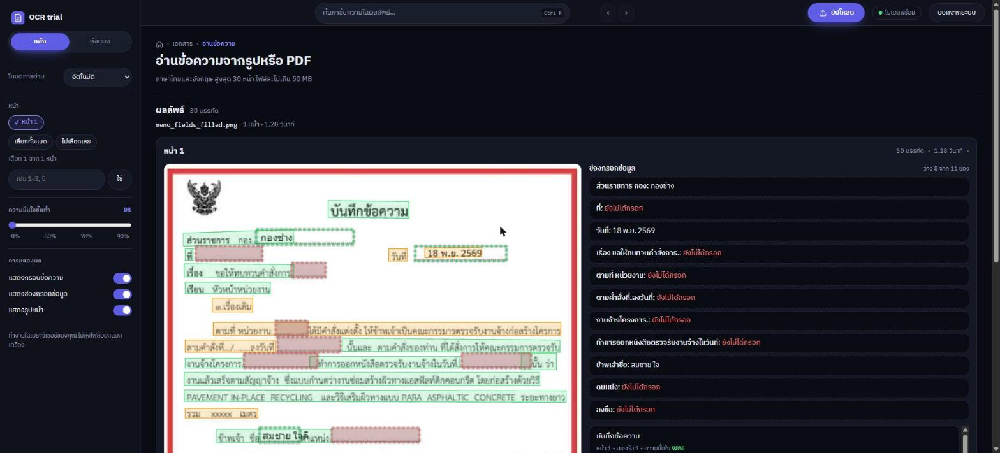

# Thai OCR

อ่านข้อความภาษาไทยและอังกฤษจากรูปภาพและ PDF ทำงานบน CPU ไม่ต้องใช้ GPU

   [](https://huggingface.co/iapp/OpenThai2.0-OCR-Text)



## ความสามารถ

- อ่านไฟล์เล็ก (ไม่เกิน 30 หน้า, 50 MB) ในเบราว์เซอร์ด้วย onnxruntime-web ไฟล์ไม่ออกนอกเครื่อง
- ไฟล์ใหญ่ (เล่มหนาถึง 1000 หน้า) ส่งเข้าคิวบน server อ่านต่อได้หลังรีบูต
- แสดงกรอบข้อความบนรูปพร้อมสีตามความมั่นใจ
- หาช่องกรอกข้อมูลในแบบฟอร์ม (เช่น บันทึกข้อความ) และบอกช่องที่ยังว่าง
- ค้นหาข้อความในผลลัพธ์ (Ctrl K) กรองตามความมั่นใจ เลือกหน้า
- คัดลอกหรือดาวน์โหลดเป็นไฟล์ .txt
- ระบบ login ด้วยรหัสผู้ใช้และรหัสแอดมิน
- หน้า admin ดู CPU, RAM, คิวงาน และสถิติ

## เริ่มใช้งาน

### Server (แนะนำ)

```
python -m venv .venv
.venv\Scripts\activate
pip install -r requirements.txt
npm install
npm run build
python -m server passwords --user <รหัสผู้ใช้> --admin <รหัสแอดมิน>
python -m server
```

เปิด http://127.0.0.1:7860

ค่าที่ตั้งได้ด้วย environment variable:

| ตัวแปร | ค่าเริ่มต้น | ความหมาย |
|---|---|---|
| `PORT` | `7860` | พอร์ตที่ server ฟัง |
| `HOST` | `0.0.0.0` | ที่อยู่ที่รับการเชื่อมต่อ |
| `OCR_DATA` | `data/` | โฟลเดอร์เก็บข้อมูลงานและการตั้งค่า |
| `OCR_WORKERS` | `2` | จำนวน worker ที่อ่านงานพร้อมกัน |
| `OCR_THREADS` | `3` | จำนวน thread ต่อ worker |

บน Windows:

- `tools/install_server.ps1` ติดตั้ง server เป็น Scheduled Task ชื่อ `ThaiOCR Server` และตั้งกฎไฟร์วอลล์ รันด้วยสิทธิ์ Administrator
- `tools/change_passwords.cmd` ใช้เปลี่ยนรหัสผ่าน (ขอสิทธิ์ Administrator) หลังเปลี่ยนต้องเริ่ม server ใหม่

### เวอร์ชันเดี่ยวแบบเก่า

```
python web_app.py
```

เปิด http://127.0.0.1:8000 หน้าเว็บอยู่ที่ `web/index.html` ไฟล์นี้ใช้กับ `Dockerfile`

## ทดสอบ

ทดสอบฝั่ง Node (ไฟล์ใน `tests/`):

```
npm test
```

ทดสอบฝั่ง Python (ไฟล์ใน `tests_py/`):

```
pip install -r requirements-dev.txt
python -m pytest tests_py -q
```

## โครงสร้างโปรเจกต์

```
site/                    หน้าเว็บ index/login/admin
├── js/                  engine ฝั่งเบราว์เซอร์
├── models/              โมเดล ONNX (สร้างด้วย npm run build)
└── vendor/              ไลบรารีฝั่งเบราว์เซอร์ (สร้างด้วย npm run build)
server/                  HTTP server, คิวงาน, auth, สถิติ
OpenThai2.0-OCR-Text/    โมเดล ONNX และ runtime Python
web/ + web_app.py        เวอร์ชันเดี่ยวแบบเก่า
tests/                   ทดสอบ Node
tests_py/                ทดสอบ pytest
tools/                   สคริปต์ build และติดตั้ง
docs/images/             ภาพหน้าจอสำหรับ README
```

## สัญญาอนุญาต

โปรเจกต์นี้ใช้สัญญาอนุญาต [Apache-2.0](LICENSE)

โมเดล [OpenThai2.0-OCR-Text](https://huggingface.co/iapp/OpenThai2.0-OCR-Text) โดย iApp Technology ใช้สัญญาอนุญาต Apache-2.0 พัฒนาต่อจาก PP-OCRv6 tiny ของ PaddlePaddle รายการส่วนประกอบอื่นดูได้ที่ [site/THIRD_PARTY.md](site/THIRD_PARTY.md)
